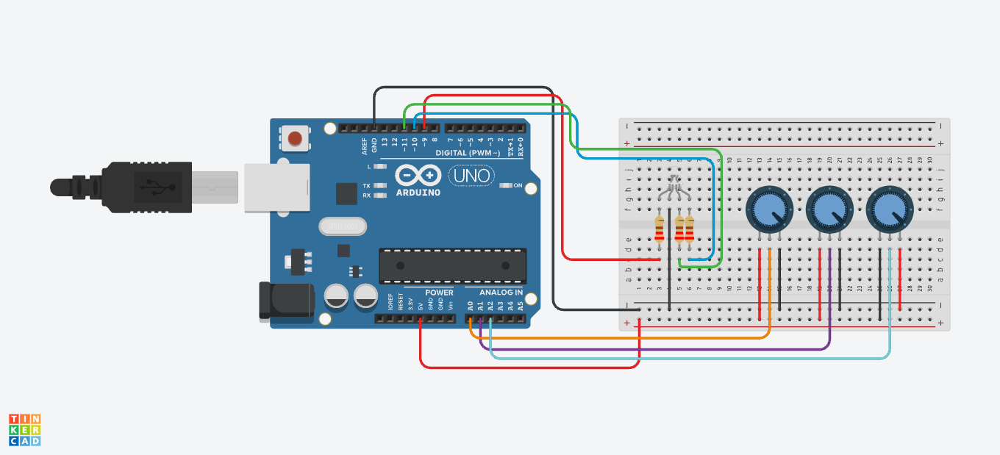

# RGB Color Mixer

## Overview

This project implements a simple RGB colour mixer using an Arduino Uno, an RGB LED, and three potentiometers. Each potentiometer adjusts the brightness of one colour channel: red, green, or blue. By combining these channels at different brightness levels, the user can create a variety of colours with a single LED.

## Components Used

| Component | Description |
|-----------|-------------|
| Arduino Uno | The microcontroller that reads the potentiometers and controls the RGB LED |
| RGB LED | Combines red, green, and blue light to produce different colours |
| 3 × 10kΩ Potentiometers | Adjust the brightness of the three colour channels independently |
| 3 × 220Ω Resistors | Limit the current flowing through the LED colour channels |
| Small Breadboard | Used to assemble and hold the circuit components |
| Jumper Wires | Used to connect the Arduino, potentiometers, resistors, and RGB LED |

## Functionality

* The Arduino continuously reads the three potentiometers.
* Each potentiometer reading is converted into a brightness value between 0 and 255.
* The program uses pulse-width modulation (PWM) to control each LED colour channel independently.
* Adjusting the potentiometers changes the mixture of red, green, and blue light.
* When all three brightness values are zero, the LED turns off.

## Code Explanation

This Arduino program configures the three LED pins as outputs using `pinMode()`. Inside `loop()`, it reads the potentiometers using `analogRead()`, which returns values between **0 and 1023**. Each reading is divided by **4** using integer division to produce a value between **0 and 255**, suitable for `analogWrite()`. The program then sends these values to the LED pins using PWM, adjusting the brightness of each colour channel. The loop repeats continuously without an explicit delay.

### Pin Setup

The code reads the red, green, and blue controls from analog pins **A0**, **A1**, and **A2**, respectively. It assigns digital PWM pins **D9**, **D10**, and **D11** to the red, green, and blue LED channels. Each LED colour channel requires a **220Ω resistor**, and the common cathode connects to **GND**. The outer terminals of each **10kΩ potentiometer** connect to **5V** and **GND**, while the centre terminal connects to its corresponding analog input.

### Behaviour

When the system starts, the Arduino reads the current potentiometer positions and sets the LED brightness accordingly. Turning a potentiometer changes the brightness of its assigned channel while leaving the other channels under their own controls. Combining red and green produces yellow, red and blue produces magenta, and green and blue produces cyan. Turning all channels up produces a combined light that appears approximately white, while setting all channels to zero turns the LED off. The Arduino continuously updates the outputs as the controls are adjusted.

## Simulation

Created using Autodesk [Tinkercad Circuits](https://www.tinkercad.com/circuits).

## License

This project is licensed under the [MIT License](../LICENSE).
